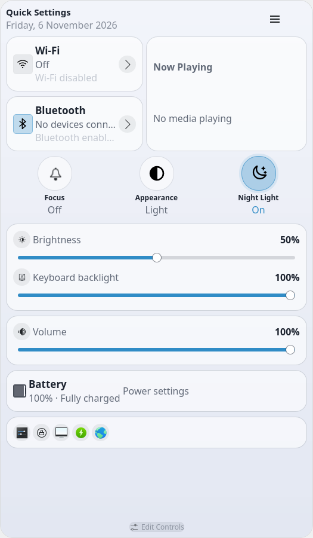
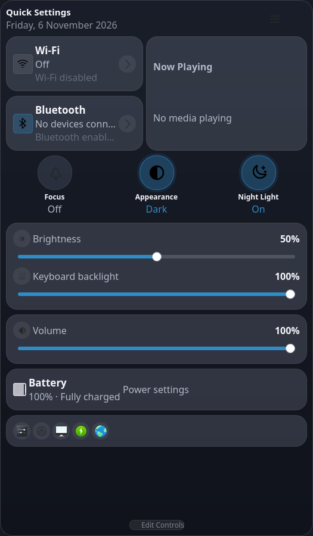
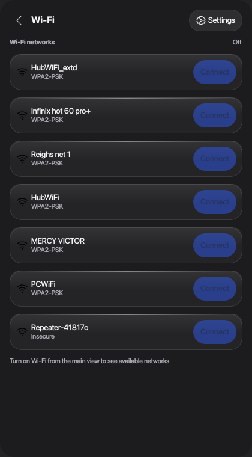
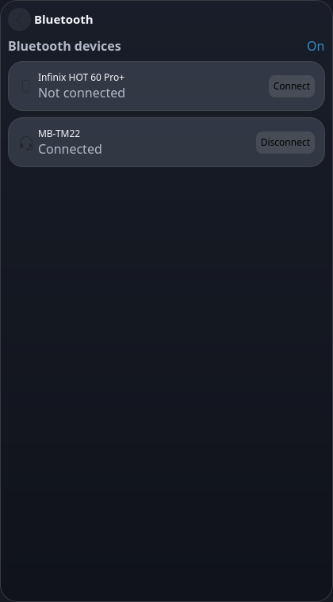
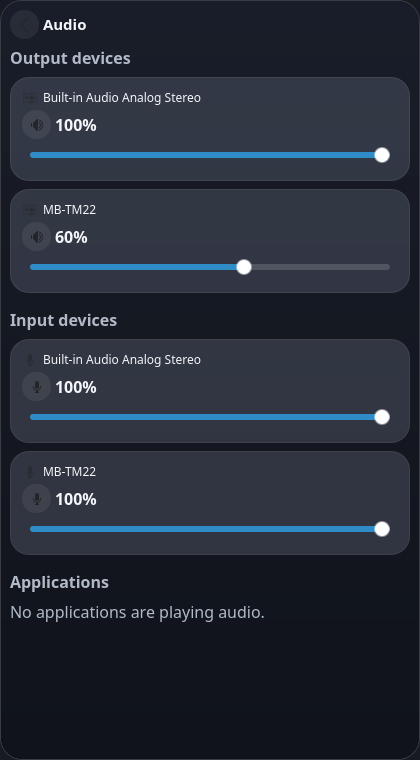
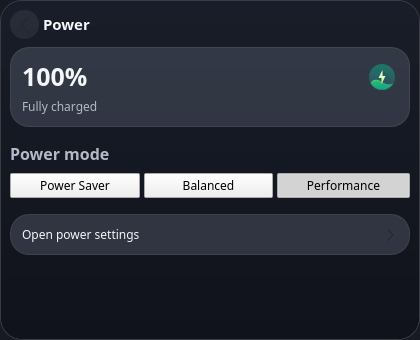

# Quick Settings

A modern glass control panel for KDE Plasma 6. Quick Settings keeps frequently
used desktop controls in one place: connectivity, brightness, volume, media
playback, focus mode, appearance, battery and power management.



Screenshots show the real widget; see [screenshots/README.md](screenshots/README.md)
for the full set and capture notes.

## Features

- Native Plasma 6 panel applet with a compact, animated panel icon.
- Floating, rounded glass panel with translucent cards and blur where KWin
  supports it.
- Light and dark appearance, with the system accent colour by default.
- Appearance and Night Light quick toggles that stay in sync with the system.
- Live system state for Wi-Fi, Bluetooth, volume, screen brightness, media,
  notifications and battery.
- Separate Wi-Fi, Bluetooth, audio and power detail views inside the same popup.
- Per-module visibility, spacing, transparency, corner radius, animation and
  quick-action configuration.
- QML-only implementation: no compiled plugin and no root privileges required.

## Requirements

- KDE Plasma 6.0 or newer (developed against Plasma 6.6).
- Qt 6 and the Plasma QML components (`plasma-workspace`, `libplasma`).
- The standard Plasma integration modules used by the desktop:
  - NetworkManager and `plasma-nm` for Wi-Fi.
  - BlueZ and `bluez-qt` for Bluetooth.
  - PipeWire or PulseAudio through `plasma-pa`.
  - MPRIS for media players.
  - UPower / PowerDevil for battery and power profiles.
- `plasma-apply-colorscheme` from `plasma-workspace` for light/dark switching.

All integrations are optional at runtime. Missing hardware or services result
in an unavailable state instead of a broken widget.

## Installation

From this repository:

```bash
kpackagetool6 -t Plasma/Applet -i package/
```

To update an installed development copy:

```bash
kpackagetool6 -t Plasma/Applet -u package/
```

To remove it:

```bash
kpackagetool6 -t Plasma/Applet -r com.github.peter-njoro.quicksettings
```

Then right-click your panel, choose **Enter Edit Mode → Add Widgets**, search
for **Quick Settings**, and place it on the panel.

During development you can preview the applet with the Plasma SDK:

```bash
plasmoidviewer -a com.github.peter-njoro.quicksettings
```

If `plasmoidviewer` is unavailable, use the windowed preview:

```bash
plasmawindowed com.github.peter-njoro.quicksettings
```

## Packaging

Create the distributable archive from the project root:

```bash
./scripts/package.sh
```

This produces `quick-settings-<version>.plasmoid` in the project root. The
archive contains only the contents of `package/`, not the development files.

## Configuration

Open the widget menu (three dots) and choose **Configure Quick Settings…**, or
right-click the applet and choose **Configure**. Configuration is stored with
KConfig and persists between sessions.

Available settings include:

- Automatic, light or dark appearance; accent colour following.
- Optional custom panel icon with an icon picker and reset to the bundled default.
- Transparency, glass effect, corner radius, compact spacing, animations and
  animation speed.
- Visibility of each module (Wi-Fi, Bluetooth, brightness, volume, focus,
  appearance, Night Light, media, battery and quick actions).
- Header date visibility, close-on-outside-click and whether the popup
  remembers the last view.
- Individual quick actions for System Settings, lock screen, display, power,
  network, Bluetooth and audio settings.

## Development

Validate the QML sources:

```bash
./scripts/lint.sh
```

Useful Plasma tools:

```bash
kpackagetool6 -t Plasma/Applet -i package/
plasmoidviewer -a com.github.peter-njoro.quicksettings
plasmawindowed com.github.peter-njoro.quicksettings
```

### Architecture

```text
package/
├── metadata.json
└── contents/
    ├── config/          # KConfig XT definition and configuration UI
    └── ui/              # Applet entry point, views and reusable components
```

System integration is intentionally isolated per component so it can be tested
independently. The widget prefers supported Plasma QML APIs and KDE settings
modules over shell commands. Where a stable API does not exist, it uses the
official KDE utility for that task (for example
`plasma-apply-colorscheme` for appearance switching and `kwriteconfig6` for
turning Night Light on or off).

## Troubleshooting

- **The widget does not appear:** confirm the package structure and reinstall
  with `kpackagetool6 -t Plasma/Applet -u package/`.
- **Blur is unavailable:** disable the translucent glass cards in the widget
  settings for an opaque, readable fallback; blur itself depends on the
  compositor and Plasma theme.
- **A card shows unavailable:** the required service or hardware is missing.
  Verify NetworkManager, BlueZ, PipeWire/PulseAudio, UPower and PowerDevil are
  running.
- **Media controls are empty:** start an MPRIS-compatible player and make sure
  it exposes the MPRIS D-Bus interface.
- **QML errors while developing:** run `./scripts/lint.sh` and check the
  Plasma session log (`journalctl --user -b -u plasma-plasmashell`).

## Screenshots

| Main panel (light) | Main panel (dark) |
| --- | --- |
|  |  |

| Wi-Fi | Bluetooth | Audio | Power |
| --- | --- | --- | --- |
|  |  |  |  |

All screenshots are rendered from the actual QML sources; no mockups are used.

## License

GPL-3.0-or-later. See [LICENSE](LICENSE).

## Contributing

Bug reports and merge requests are welcome at
<https://github.com/peter-njoro/quicksettings>.
